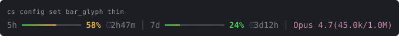
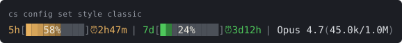

<div align="center">

# Claude Status Bar

**Your Claude Code usage, at a glance.**
5h / 7d rate-limit bars, reset countdowns, model, context window, and prompt-cache
freshness — inline in Claude Code's status line, or a floating HUD on the desktop app.

[](https://pypi.org/project/claude-statusbar/)
[](https://pepy.tech/project/claude-statusbar)
[](https://pypi.org/project/claude-statusbar/)
[](https://github.com/leeguooooo/claude-code-usage-bar/actions/workflows/ci.yml)
[](LICENSE)
[](https://github.com/leeguooooo/claude-code-usage-bar/stargazers)

**English** · [简体中文](README.zh-CN.md) · [Install](docs/install.md) · [Documentation](#documentation)


</div>

Claude Code tells you almost nothing about where you stand against your rate limits.
`cs` puts the numbers that matter on one quiet line at the bottom of your terminal:
how much you have left, and when it resets.

| Line | Segments |
|---|---|
| **Usage** | 5h / 7d rate-limit bars, reset countdowns, end-of-window projections (`→NN%`), model & context window, prompt-cache countdown, optional session cost or relay balance |
| **Project** | git worktree marker (`name (🌳3)` / `worktree (🌳3)`), project name, branch, session `+/−` lines, duration, version |

- **Official numbers** — the same 5h / 7d limits Claude Code enforces, not a local guess.
- **Prompt-cache countdown** — `❄ 4m23s` tells you when the next turn pays full price.
- **Two surfaces** — the terminal `statusLine`, or a floating HUD for the Claude desktop app (macOS).
- **Fast** — native cache reader plus a background daemon; well under 1% CPU at one refresh per second.
- **Opt-in extras** — cost, relay balance, git ahead/behind, activity, IP checks, [IELTS writing-coach](https://github.com/leeguooooo/prompt-language-coach) progress.

## Install

```bash
curl -fsSL https://raw.githubusercontent.com/leeguooooo/claude-code-usage-bar/main/install.sh | bash
```

A prebuilt binary for macOS Apple Silicon and Linux x86_64 — no Python needed. On macOS it
also registers the desktop HUD when the Claude app is installed. Other platforms fall back to pip.

**Windows** (PowerShell, no admin):

```powershell
irm https://raw.githubusercontent.com/leeguooooo/claude-code-usage-bar/main/install.ps1 | iex
```

**pip / uv:**

```bash
pip install claude-statusbar     # or: uv tool install / pipx install
cs --setup                       # wires the statusLine hook + installs the skill
```

Restart Claude Code and the bar appears. `cs` upgrades itself every 6 hours; if you're stuck on
an old version, run `cs upgrade` or re-run the one-liner
([why](docs/troubleshooting.md#stuck-on-an-old-version)). More paths in the **[install guide](docs/install.md)**.

## Customize

Three looks — aurora with block bars (default), aurora with a thin line, and classic:




```bash
cs theme                         # pick one with a live preview (↑/↓, Enter)
cs config set bar_glyph thin     # thin ━ line instead of ■ blocks (default)
cs config set style classic      # the original battery-bar look
cs config set narrow_layout stack # stack 5h / 7d bars in narrow panes
cs preview                       # all three looks, with your real numbers
cs config show                   # every key, and which ones you changed
```

## Desktop app (macOS) — `cs hud`

The desktop app has no status line, so `cs hud` adds an always-on-top floating panel with the
same official usage. The one-liner installs it; for pip use `pip install 'claude-statusbar[hud]' && cs hud install`.

<div align="center">


</div>

## Documentation

| Guide | What's inside |
|-------|---------------|
| [Install](docs/install.md) | Binary, PyPI, skill-only, plugin, Codex bridge |
| [What it shows](docs/segments.md) | Every segment, icon and color threshold |
| [Looks](docs/styles-and-themes.md) | The three looks, slash commands |
| [Configuration](docs/configuration.md) | All keys, env vars, JSON output |
| [Desktop HUD](docs/desktop-hud.md) | The macOS floating panel |
| [Fast mode (daemon)](docs/daemon.md) | Daemon, auto-start, refresh and caching |
| [No-quota mode](docs/no-quota-mode.md) | Relay / Bedrock / Vertex layout and balance |
| [Cache countdown](docs/cache-countdown.md) | How `❄ 4m23s` is computed |
| [Troubleshooting](docs/troubleshooting.md) | `cs doctor`, IP checks, upgrading |

Want charts and weekly cost breakdowns instead of one line? Run
[ccusage](https://github.com/ryoppippi/ccusage) or
[Claude Code Usage Monitor](https://github.com/Maciek-roboblog/Claude-Code-Usage-Monitor) in a
side pane — they coexist with `cs`.

## Contributing

PRs welcome — see **[CONTRIBUTING.md](CONTRIBUTING.md)** (setup, tests, architecture, release flow)
and **[SECURITY.md](SECURITY.md)**. Changes per version: **[CHANGELOG.md](CHANGELOG.md)**.

## Acknowledgments

- [@marcwimmer](https://github.com/marcwimmer) — original `show_cache_age` widget ([#9](https://github.com/leeguooooo/claude-code-usage-bar/pull/9))
- [claude-monitor](https://github.com/Maciek-roboblog/Claude-Code-Usage-Monitor) — token-usage analysis library used as the optional fast-path data source

<a href="https://github.com/leeguooooo/claude-code-usage-bar/graphs/contributors">
  
</a>

---

<div align="center">
<sub>MIT © <a href="https://github.com/leeguooooo">leeguooooo</a> · Built for people who live in Claude Code.</sub>
</div>

## Author

Built by **郭立 (Guo Li / leeguoo)** — [leeguoo.com](https://leeguoo.com/about) · [GitHub](https://github.com/leeguooooo) · [X](https://x.com/leeguooooo) · more tools in the [*-use family](https://github.com/leeguooooo/plugins).
