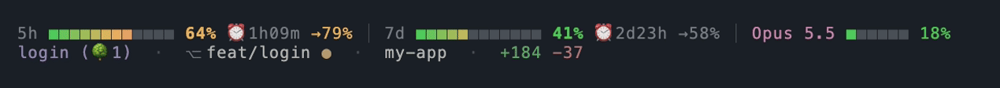
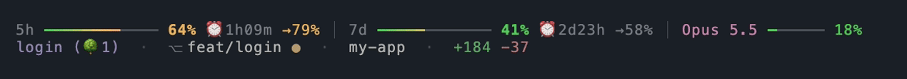
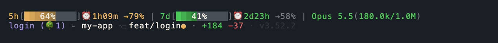

> 用 **Codex CLI**？试试姊妹项目 **[Codex Statebar](https://github.com/leeguooooo/codex-statebar)**：同款状态栏，专为 Codex 打造。

<div align="center">

# Claude Status Bar

**一眼看清你的 Claude Code 用量。**
5 小时 / 7 天限额进度条、重置倒计时、当前模型、上下文窗口、prompt 缓存新鲜度，
直接显示在 Claude Code 的状态栏里。

[](https://pypi.org/project/claude-statusbar/)
[](https://pepy.tech/project/claude-statusbar)
[](https://pypi.org/project/claude-statusbar/)
[](https://github.com/leeguooooo/claude-code-usage-bar/actions/workflows/ci.yml)
[](LICENSE)
[](https://github.com/leeguooooo/claude-code-usage-bar/stargazers)

[English](README.md) · **简体中文** · [安装](docs/install.md) · [文档](#文档)



</div>

Claude Code 几乎不告诉你离限额还有多远。`cs` 把要紧的数字压进终端底部一行：还剩多少、什么时候重置。

| 行 | 内容 |
|---|---|
| **用量** | 5h / 7d 限额进度条、重置倒计时、窗口末尾预测（`→NN%`）、模型与上下文窗口、prompt 缓存倒计时、可选的会话花费或中转余额 |
| **项目** | git worktree 标记（`名字 (🌳3)` / `worktree (🌳3)`）、仓库名、分支、本次会话 `+/−` 行数、时长、版本 |

- **官方数字**：就是 Claude Code 实际执行的 5h / 7d 限额，不是本地估算。
- **prompt 缓存倒计时**：`❄ 4m23s` 告诉你下一轮什么时候要按原价算。
- **快**：原生缓存读取加后台常驻进程，每秒刷新 CPU 也远低于 1%。
- **想要再开**：花费、中转余额、git 领先/落后、会话活动、IP 检查、[雅思写作陪练](https://github.com/leeguooooo/prompt-language-coach)进度。

## 安装

```bash
curl -fsSL https://raw.githubusercontent.com/leeguooooo/claude-code-usage-bar/main/install.sh | bash
```

macOS Apple Silicon 和 Linux x86_64 直接下载预编译二进制，不需要 Python。其他平台自动回退到 pip。

**Windows**（PowerShell，不需要管理员权限）：

```powershell
irm https://raw.githubusercontent.com/leeguooooo/claude-code-usage-bar/main/install.ps1 | iex
```

**pip / uv：**

```bash
pip install claude-statusbar     # 或：uv tool install / pipx install
cs --setup                       # 接好 statusLine 钩子，并装上 skill
```

重启 Claude Code 就能看到。`cs` 每 6 小时自动升级一次；卡在老版本的话跑 `cs upgrade`，或重新执行上面的安装命令
（[原因](docs/troubleshooting.md#stuck-on-an-old-version)）。其他安装方式见 **[安装指南](docs/install.md)**。

## 自定义

三种外观：aurora 方块（默认）、aurora 细线、classic 原版：





`cs theme` 带实时预览挑外观：


```bash
cs theme                         # 带实时预览的选择器（↑/↓ 选，回车应用）
cs config set bar_glyph thin     # ━ 细线，默认是 ■ 方块
cs config set style classic      # 原来的电池条样式
cs config set narrow_layout stack # stack quota bars in narrow panes
cs preview                       # 三种外观放一起看，用你的真实数据
cs config show                   # 所有配置项，以及你改过哪些
```

## 文档

| 指南 | 讲什么 |
|-------|---------------|
| [安装](docs/install.md) | 二进制、PyPI、只装 skill、插件、Codex 桥接 |
| [显示什么](docs/segments.md) | 每一段、每个图标、每档配色阈值 |
| [外观](docs/styles-and-themes.md) | 三种外观、slash 命令 |
| [配置](docs/configuration.md) | 全部配置项、环境变量、JSON 输出 |
| [快速模式（常驻）](docs/daemon.md) | 常驻进程、开机自启、刷新与缓存策略 |
| [无额度模式](docs/no-quota-mode.md) | 中转 / Bedrock / Vertex 布局与余额 |
| [缓存倒计时](docs/cache-countdown.md) | `❄ 4m23s` 是怎么算的 |
| [排障](docs/troubleshooting.md) | `cs doctor`、IP 检查、升级 |

想要图表和按周的花费拆解？在侧边窗格开 [ccusage](https://github.com/ryoppippi/ccusage) 或
[Claude Code Usage Monitor](https://github.com/Maciek-roboblog/Claude-Code-Usage-Monitor)，和 `cs` 并存没问题。

**[ccx](https://github.com/aaronwong1999/ccx)** 在 macOS 上把 Claude Code 会话和 Codex 对话关联起来。
装了状态栏后，Claude 的 5 小时额度超过 90%，或每周额度用尽时，ccx 的菜单栏应用会提醒你，并可一键把最新的会话
切到 Codex 接着做（不用配置；ccx 在 `~/.cache/claude-statusbar/last_stdin.json` 较新时读取其中的 `rate_limits`）。

## 参与贡献

欢迎 PR，先看 **[CONTRIBUTING.md](CONTRIBUTING.md)**（环境、测试、架构、发版流程）和
**[SECURITY.md](SECURITY.md)**。每个版本的改动见 **[CHANGELOG.md](CHANGELOG.md)**。

## 致谢

- [@marcwimmer](https://github.com/marcwimmer)：最初的 `show_cache_age` 组件（[#9](https://github.com/leeguooooo/claude-code-usage-bar/pull/9)）
- [claude-monitor](https://github.com/Maciek-roboblog/Claude-Code-Usage-Monitor)：用作可选快路径数据源的 token 用量分析库

<a href="https://github.com/leeguooooo/claude-code-usage-bar/graphs/contributors">
  
</a>

---

<div align="center">
<sub>MIT © <a href="https://github.com/leeguooooo">leeguooooo</a> · 为长在 Claude Code 里的人而做。</sub>
</div>

## 作者

**郭立（Guo Li / leeguoo）** 开发 —— [leeguoo.com](https://leeguoo.com/about) · [GitHub](https://github.com/leeguooooo) · [X](https://x.com/leeguooooo) · 更多工具见 [*-use 家族](https://github.com/leeguooooo/plugins)。

